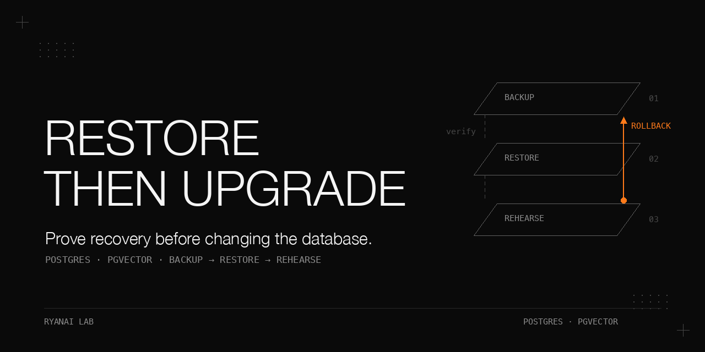

# Restore first, then upgrade: a Postgres + pgvector knowledge base

An upgrade is only as safe as the return path you have actually exercised. For 22 days, our 2.3 GB database had 344 GB of write-ahead logs on the primary and another 344 GB on a mirror, but no physical base backup from which to replay them. This book follows the repair of that chain, isolated restore drills, fork audits, and a rehearsal across 21 non-reversible migrations. The rehearsal found four cut-over preconditions and a write-protocol blocker. A snapshot taken around cut-over then caught what the rehearsal had not exercised: a re-import that resurrected 37 soft-deleted pages.

Historical observations below come only from the supplied fact sheet. The scripts are public adaptations, and the fixtures are synthetic. The offline tests validate their mechanics and failure branches; they do not establish recoverability of a real database.

## Why this matters

A scheduled job can complete while its output is unusable. A verifier can reject a sound copy using an obsolete manifest. An upgrade can preserve every page during migration and still damage state when the background daemon resumes.

The useful evidence is specific: a reconciled restore, the actual running server's directory and recovery state, an adjudicated difference between failing-test sets, and a per-page comparison after the first background cycle.

The backup script shipped here checks every step, including rsync. **That check was added while writing this book; this is not the version that produced the historical logs.** Seven historical rsync errors were followed by `backup OK`; their effect on those backups was not analyzed.

## What is in this book

1. [A backup nobody had restored](docs/backup-chain.md): establish the missing base, recover, reconcile, then trim WAL.
2. [The restore drill and the stale verifier](docs/restore-drill.md): isolate recovery, refuse redirection, and interpret a stale manifest.
3. [Restores as an operating tool](docs/recovery-uses.md): recover rows, establish rollback anchors, and compare after crash recovery.
4. [Which patches survive](docs/fork-verdicts.md): classify each local change from target behavior across the recorded rounds.
5. [Proving the rebase](docs/rebase-proof.md): pre-screen functions, maintain decisions, check survival, and compare full test runs.
6. [Rehearsing the database upgrade](docs/upgrade-rehearsal.md): restore realistic data, preserve completion records, and find protocol blockers.
7. [Cut-over and its blind spots](docs/cutover.md): freeze writers, switch deliberately, and detect background re-import damage.

[All tables](docs/results.md), [expanded pitfalls](docs/pitfalls.md), and [script contracts](docs/offline-reproduction.md) provide the detail behind the shorter chapters below.

## The setting

| Item | Recorded setting or prerequisite |
|---|---|
| Historical database host | Apple silicon Mac; Homebrew PostgreSQL 17.10; pgvector 0.8.2; launchd |
| Mirror | A second Linux machine receiving backups over SSH and a WAL copy every 5 minutes |
| Database in July | 2.3 GB; 8,693 pages; 33,275 chunks |
| Upgrade assessment inventory | ~5 GB; 23,698 pages, 23,658 live; 135,607 chunks |
| Knowledge base | An unnamed open-source Postgres + pgvector application, locally forked; ~14 local commits; 12 minor versions crossed |
| Schema transition | 144 -> 165; 21 migrations; no down migrations |
| Second fork | An unnamed open-source agent runtime; 39 local commits at the audited rebase |
| Reader's prerequisites | PostgreSQL 15+ with archiving, a separate directory and port, application-specific migration adapters |
| Tools | `psql`, `rsync`, `pg_ctl`, `pg_archivecleanup`, `pg_basebackup`, `pg_verifybackup`, `lsof`, bash, Python 3 standard library |

The July and upgrade-time inventories are separate snapshots; see [the July restore](docs/backup-chain.md#procedure-as-actually-run-2026-07-04) and [the upgrade rehearsal](docs/upgrade-rehearsal.md#procedure-as-actually-run-three-migration-runs) for their conditions.

The exact reader-side binary paths and application commands are unknown. Supply them explicitly. Set `LC_ALL` and `LANG` on macOS and do not assume a service inherits the interactive PATH. Restore, migration, rebuild, re-embedding and cut-over timings are intentionally omitted.

## 1. A backup nobody had restored

Conditions: 2026-07-04 incident; backup logs cover 2026-07-04 through 2026-09-22.

**Problem.** On 2026-07-04, a disk audit found 344 GB of WAL on each machine for a 2.3 GB database: 150x write amplification on the primary. The only backups were logical dumps. The 22 days of archived WAL therefore supplied no point-in-time restore chain.

**Mechanism.** A stale maintenance anchor caused a full-table update on every cycle. A short archive timeout also forced segments while idle. The historical WAL decomposition is approximate: about 240 GB is attributed and roughly 100 GB remains unattributed; the original `pg_waldump` output was not retained.

| Component | Recorded quantity and condition |
|---|---|
| Write storm | Anchor stale for 13 days; ~2.4-minute cycles; ~9,400 rows; 6.04 million updates; 337 MB GIN index rewritten each cycle |
| Storm WAL | 93% GIN records in storm segments; 8.2 GB/h for 16 h; about 130 GB; incident write-up only |
| Idle arithmetic | 16 MB every 5 minutes at `archive_timeout = 300`; 288 segments/day, about 4.6 GB/day; ~5 GB/day x 22 days = ~100-110 GB |
| Unattributed remainder | 130 + ~110 leaves roughly 100 GB; not a measured allocation |

Because the archive was inside PGDATA, `pg_basebackup` would have copied it too. The low-level alternative is one psql session: `pg_backup_start`, a shell copy excluding `archive/` and `pg_wal/*`, then `pg_backup_stop`. Save the returned `labelfile` as `backup_label`; its start WAL file defines the retention boundary.

The published copy helper writes a success marker only after rsync exits successfully. The outer script checks psql, that marker, and `START WAL LOCATION`. It also excludes `backup_manifest`. Copy or mirror failure prevents subsequent cleanup. Optional cleanup requires `CLEANUP_PROVEN=yes`, an operator assertion that this chain has already passed independent reconciliation.

**Procedure as run.** Take the 2.3 GB backup; restore a copy on port 5433 using the archive and `recovery.signal`; wait for `consistent recovery state reached` and `archive recovery complete`. Compare page count, chunk count, last-sync timestamp and max updated-at against the primary. Only after the 4/4 match, trim both archives to the start segment.

| Result | Condition |
|---|---|
| 8,693 pages; 33,275 chunks; 4/4 values identical | First restore, 2026-07-04 |
| Primary 344 GB -> 16 MB; mirror 344 GB -> 17 MB; 688 GB reclaimed | Trimming after that reconciliation |
| 81 calendar days; 82 logged successful runs, 82 logged successful copies; 1 failed run | 2026-07-04 through 2026-09-22; original host's log, not 82 restore proofs |
| 79 runs at 04:00; 3 manual or late | The 82 logged successful runs |
| 16 MB archive after 79 of 82 runs; 32 MB, 48 MB, 160 MB on the others | Daily-retention log lines |
| 7 `rsync: unexpected end of file` occurrences still followed by `backup OK` | Historical unchecked shell-copy status |

**What did not work.** Process health hid the missing base. On 2026-07-05 at 04:00, bare `psql` failed under launchd's minimal PATH; the alert fired and no WAL was trimmed. The manual rerun succeeded. `head -n -2` also failed on BSD; retention uses `sort -r | tail -n +3` to keep the newest 2 backups.

Tuning changed `wal_compression` to `zstd`, `archive_timeout` 300 -> 1800 and `checkpoint_timeout` 300 -> 1800 with a reload. The ~80% idle-noise reduction was estimated, never measured.

**Rule.** Reconcile a restore before trusting or trimming the chain. A logged copy success does not substitute for that result.

## 2. The weekly restore design and why the verifier lies

Conditions: 2026-09-27 manual drill and a later manual re-run; the real throwaway-cluster reproduction date was not supplied.

**Problem.** On 2026-09-27, an audit found 809 WAL-copy runs with 0 non-zero exits but no automatic restore since the July proof. `pg_verifybackup` then reported about 110 checksum errors on each of the two newest backups.

**Mechanism.** An earlier `pg_basebackup` had left `backup_manifest` in the live directory. Low-level rsync backups carried it forward even though their data had changed. The verifier compared current data to an old manifest; the low-level API had not produced a new one.

| Recorded real-cluster reproduction observation | Condition |
|---|---|
| 21 checksum mismatches; 4 files absent from manifest; 2 size mismatches | Good low-level backup carrying a stale manifest; reproduction date not supplied |
| `pg_waldump: could not find any WAL file`; `WAL parsing failed for timeline` | 1 + 1 messages; `pg_wal` excluded, required WAL in archive |
| Manifest byte-identical to the stale source manifest | Same reproduction |
| 260,000 of 270,000 rows visible | Restore paused at first consistency; later commits expected absent |

**Procedure as run.** Move the stale manifest out of PGDATA, exclude it from future copies, and restore the newest backup containing `backup_label`. Allocate a private `mktemp` directory; require `lsof` and a free loopback port. Refuse every symlink, `tablespace_map`, non-empty `pg_tblspc`, and path/include/replication setting in either configuration file.

Set `recovery_target = 'immediate'`, action `pause`, `hot_standby = on`, and empty replication settings. Pin data directory, port, loopback listen address and `archive_mode=off` on the server command line. Then read back `<copy>|off|true` from the running server. Require a positive page count within +/-10% of production; stop before removing the workspace. A failed stop keeps the directory and fails the result.

| Manual run | Drill pages | Production pages | Condition |
|---|---|---|---|
| First, 2026-09-27 | 18,331 | 18,360 | Within +/-10% |
| Later re-run | 18,331 | 18,363 | Production had gained pages; exact date not supplied |

**What did not work.** The first review found 2 drill-specific BLOCKERs, 3 MAJORs and 2 MINORs. They covered storage redirection, replication, workspace collision, swallowed stop failures, hidden `lsof`, and malformed JSON. The whole change set had 3 BLOCKERs, 9 MAJORs and 3 MINORs; those totals include other scripts. Rounds 2 through 5 added four MAJOR findings; round 5 passed, with 14 fixes and 1 rejected item overall.

**Rule.** A recovery check must prove both content plausibility and isolation. The design calls for Sunday 05:30, but schedule registration and an unattended result remain unconfirmed; see Limits.

## 3. Restores as an operating tool

Conditions: Dated recovery uses from 2026-07-04 through 2026-10-02; these are distinct baselines.

**Problem.** A database and its file mirror were not equivalent copies. Re-enabling a background daemon on 2026-09-27 overwrote database-only content and confidential markers without deleting pages.

**Mechanism.** Restore the earlier physical backup in isolation, extract selected rows as JSON, and combine that evidence with the version-history table. Apply recovery through the normal write path. Derive the expected recovery set independently; compare bodies, fact blocks and frontmatter dictionaries with explicit allowed differences.

**Procedure as run.** Stop the daemon. Recover shell-only pages using the pre-sync database body while keeping the file's fact table; for rewritten pages retain the file version and append original database text. Restore the privacy marker. Check exact set equality and retained body lines.

| Evidence | Condition |
|---|---|
| 6 body pages; 31 marker pages; 2 overlap; 35 unique | Recovery set on 2026-09-27; equality verified |
| Largest body 174,798 -> 433 characters | Overwrite incident; zero pages deleted |
| No lost body lines or fact blocks | Recovery verification; allowed metadata changes recorded in chapter detail |
| 21,765 pages: 9,835 identical; 11,644 database-only; 283 with database-only keys, 230 of those privacy; 3 with body missing from mirror | Same-day read-only reconciliation |
| 5.7 GB rehearsal backup; 6.3 GB freeze anchor | Upgrade preparation, 2026-09-29; different backup points |
| 2,081 new pages; 1 legitimately changed daily page; no losses or resurrections | 2026-10-02 comparison after post-migration power loss and crash recovery |

**What did not work.** The file mirror lacked 11,644 database pages, so it could not recover the overwritten bodies. A writer's success message was also insufficient evidence of recovery.

**Rule.** Exercise the chain for incident recovery, rehearsal and rollback. Judge recovery by independently derived sets and fields.

## 4. Which patches survive

Conditions: Rounds A through E retain their own dates, denominators and unfinished status.

**Problem.** Commit titles and old summaries repeatedly understated the fork delta. A similarly named upstream guard can implement different behavior.

**Mechanism.** Keep a row per local commit: files touched, apply result, upstream equivalence evidence, live dependency and verdict. Use keep, keep (rewrite), partial, skip (absorbed upstream), retire, or re-evaluate later. An ancestor check or a behavior test can justify absorption; a name match cannot.

**Procedure as run.** Re-measure the target range, reconcile every ledger entry including previously dropped patches, and inspect the target code paths. Re-implement guards when upstream moved their entry points. The records contain rounds A through E; E stopped at triage.

| Round and date | Local delta | Recorded disposition |
|---|---|---|
| A, 2026-08-29, knowledge base | 17 commits; 695+ upstream commits, 4 minors, 22 migrations | KEEP 3; DROP 9; REWRITE 5 |
| B, 2026-09-28, knowledge base | 14 commits; 12 minors, 21 migrations | 1 skip; 2 obsolete; 2 ledger/doc rewrites; 9 keep or port, in three groups |
| C, 2026-07-27, agent runtime | 43 commits + 1 uncommitted file | First: retire 3, keep 5, reimplement 30, uncertain 6; reimplementation consolidated into 4 work items |
| D, 2026-09-04, agent runtime | 39 commits: 37 non-merge + 2 merges; 59 files, +4,713 / -172 | Upstream changed 8,638 files, 40 overlapping; fork-only symbols had zero equivalents in target |
| E, 2026-09-18, agent runtime | 41 rows; target 10,722 commits later | 5 clean, 35 conflicts, 1 n/a; 31 keep, 3 partial, 4 upstream-has-it, 3 re-evaluate; unfinished |

**What did not work.** The July "keep 5" summary was stale in round D. In round A, a false equivalence would have reduced visibility from 15,224 pages to 21, a 99.86% loss. A keyword-role switch was also mistaken for a different upstream fallback. The Round B verdict breakdown is in [the chapter](docs/fork-verdicts.md); rounds A, C, D and E have summary results only.

**Rule.** Measure each round anew and prove behavior before retiring a patch.

## 5. Proving the rebase

Conditions: Round D, 2026-09-04; serial integration/pristine comparison in the same environment.

**Problem.** Conflict markers disappearing does not prove local behavior survived. Hunk headers can also attribute an untouched function to a commit.

**Mechanism.** The rewritten `prescreen-rebase.py` walks `<base>..<local-branch>`, lists touched files, classifies upstream overlap using history since the merge-base date, extracts names from hunk headers and additions, and searches the target with portable ERE character classes. Its CSV leaves `checked` and `verdict` blank for human review.

**Procedure as run.** Self-test known-present symbols; maintain the decisions ledger in application order; parse and assert symbols after each conflict; repeat the name check against the integrated tree. Map every missing function to a deliberate verdict. Run the full integration and pristine suites serially in the same environment, with each test file in a separate subprocess and one retry.

| Pre-screen or survival result | Condition: round D, 2026-09-04 |
|---|---|
| 102 file rows over 37 non-merge commits | 67 overlap; 34 new; 1 clean |
| 94 functions present; 14 missing | Missing: 10 tests, 3 own new symbols, 1 removed production function |
| 36 applied; 1 absorbed; 2 merges skipped | Merge commits added zero increment |
| 314 functions present; 12 missing; 0 unmapped | Post-rebase missing names all linked to ledger decisions |

| Full suite | Integration | Pristine |
|---|---|---|
| Test files | 3,510 | 3,493 |
| Passed | 42,281 | 42,144 |
| Failed | 52 in 26 files | 51 in 25 files |
| Skipped | 370 | 370 |
| Flaky, re-run once per file | 0 | 0 |

Conditions: same environment; serial trees; first run used 12 workers; runner options `--file-retries 1 --file-timeout 600`. The comparison found 2 integration-only files, 1 pristine-only and 24 shared. One integration-only failure was an intentional login-path change; the other required moving a raw config read into its owner module. Final adjudicated regressions: 0; final branch: 39 commits, comprising 36 cherry-picks and 3 fixups.

**What did not work.** `\s\b` in macOS git ERE falsely marked every function absent. Resolving conflicts dropped a telemetry hook pinned by tests; a changed precondition rejected a 9-character placeholder where 10 were required; a stale stub swallowed a new keyword argument. A silence-filter fixture returning `ok` made a delivery test wait instead of deliver.

Service cut-over backed up definitions and recorded the loaded set, switched exactly that set, and verified full process command lines. The code-only rollback drill worked on that runtime's migrated state, then switched forward again. That observation does not imply the knowledge-base queue migration is reversible. The interactive wrapper and shell alias needed separate switching.

**Rule.** Accept a rebase only after accounting for missing behavior and adjudicating integration-only failing tests. The published pre-screen is a rewrite; the original was not retained.

## 6. Rehearsing the database upgrade on a restored copy

Conditions: 2026-09-29 rehearsal unless the previous 2026-08-29 round is named; elapsed migration rates omitted.

**Problem.** Any new-version connection auto-applied 21 irreversible schema migrations. The queue protocol also changed. Moving a binary onto PATH outside the freeze window was already a migration action.

**Mechanism.** Restore a realistic copy, promote it, rewrite its content paths and assert zero old paths remain. Isolate HOME, application state, temporary files and credentials. Install production-identical completion records and put a shim for the new CLI first on PATH. Cancel active jobs in the copy and read the production schema version before and after each run.

| Migration class | Count | Condition |
|---|---|---|
| High risk | 3 | Queue protocol/lock, per-page revision write, projection invalidation |
| Medium | 9 | Constraint, grants, derived state, triggers, effect tables and indexes |
| Low to medium | 3 | Mostly tables and indexes |
| Low | 6 | Empty tables or metadata |

None directly rewrote body, timeline or frontmatter or bulk re-embedded. That statement does not exclude derived-state changes or post-commit effects. Rollback requires the database anchor and matching file state.

**Procedure as run.** Use the 5.7 GB daily backup: 23,698 pages, 23,658 live, 135,607 chunks, 2 active jobs, schema 144. The estimate had been ~22k pages and 50k+ chunks, off by 2.7x on chunks. Watch production remain at 144.

| Run | Conditions | Result |
|---|---|---|
| run1 | No completion records; old CLI on PATH | 21 migrations -> 165; old CLI rejected: `<job queue> protocol 1 required: upgrade every producer and worker before restart`; rc 1 |
| run2 | New CLI shim; still empty ledger | Historical orchestration replay; 7 pages missing files; partial; rc 1 |
| run3 | Reset; 17 production-identical ledger entries; shim | rc 0; mechanical check complete; 16 optional source actions pending; 0 changes across 21,766 live pages |

Conditions: 2026-09-29 rehearsal; the final comparison covered body, timeline, frontmatter keys and values, privacy, facts, tags and soft-delete state. The copy was discarded and re-restored twice, returning to schema 144 both times.

The four preconditions were: new CLI already on PATH, production-identical completion records, zero active jobs before migration 149, and code replacement only inside the write freeze.

| Write-protocol probe | Write-through on, no file owner | Write-through off |
|---|---|---|
| Create | rc 1 `owner_unavailable` | rc 0 |
| Update without revision | rc 1 `owner_unavailable` | rc 1 `revision_conflict` |
| Forced update | rc 1 `owner_unavailable`, body unchanged | rc 0, body updated |
| Forced capture | rc 1 `owner_unavailable` | rc 0, receipt has `revision` |

**What did not work.** The default write-through mode blocked every write. The chosen reversible alternative was `sync.write_through = false`; file mirrors consequently stopped receiving new content. Version history and backups remained in the database chain. Claiming and activating a file owner was deferred.

Migration 153 cleared projections; keyword retrieval returned `degraded: keyword_zero, projection_pending` until rebuilding. Re-chunking discarded old vectors, about 4 chunks per page. Sample pending pages every 20 seconds for 5 minutes and an embed worker for 180 seconds on your own copy; no historical rate is published.

The isolated patch suite had 112 unique clean-tag failures and 109 port failures: 0 port-only, 3 clean-only. Four upstream tests actually managed services; no pre-run service snapshot existed, so absence of impact could not be proven. The separate service-boundary run had 20 pass, 4 skip, 0 fail.

**Rule.** Rehearse the data, completion history and execution environment together; continuously prove production stayed unchanged.

## 7. Cut-over and what the rehearsal missed

Conditions: 2026-09-29 cut-over and checks through 2026-10-02; baselines changed between stages.

**Problem.** Passing migration did not exercise the resumed daemon, changed receipts or service PATH. The first background cycle exposed a separate class of failure.

**Mechanism and procedure as run.** Freeze every writer on both hosts; verify zero application processes, connections and unfinished jobs. Take the 6.3 GB physical anchor and save config and completion records. Switch both CLI entry points to a fixed release plus patches, set database-only writes, migrate, compare, then resume gateways before the restricted daemon. Deploy compatibility patches and smoke create/reject/read-revision/update-with-revision.

Compatibility deployment reverse-applies each staged diff, compares the reconstructed base byte for byte with the live file, backs up, preserves modes and verifies replacement. Changed live files are skipped. Default is dry-run. Legacy deterministic writers temporarily gained `--force`; API writers must read a revision first.

| Cut-over result | Condition |
|---|---|
| 21,810 live pages; 0 per-page changes | Immediately after schema 144 -> 165, 2026-09-29; rc 0 |
| 21,811 live pages = 21,810 + 1 daily page; confidential 11,607; facts 93 | Post-cut-over baseline |
| 13/13 offline compatibility checks | 14 patch files, 14 full copies; 7 source hashes unchanged; 0 literal-secret hits; 0 application/database/service calls |
| 0 application errors | Gateway error log after cut-over |
| Text retrieval fully restored; vector gaps under 0.2% | A few days later; not an instantaneous cut-over result |

**What did not work.** Chunker version 6 -> 7 triggered a full re-import: 10,032 files, 65,790 chunks re-cut, 116,291 pending re-embedding. The guard blocked 2 conflicts but resurrected 37 confidential pages and picked up 14 unintended pages.

The immediate snapshot diff reported `RESTORED 37, FM_VALUE_CHANGED 19, NEW_PAGES 15`. The new pages were the 14 pickups plus the daily page. After backing up the revert, all 51 unintended pages were soft-deleted again; counts returned to 21,811 / 11,607 / 93.

The first fix missed image and managed-sync entry points. The complete fix covered markdown, images, code and managed sync with lock-and-recheck; targeted validation reported 313 pass / 0 fail over 7 files, reproduced independently. Details belong to [keeping-agent-knowledge-files-intact](https://github.com/ryangu00/keeping-agent-knowledge-files-intact).

Other surprises included `written` changing meaning, `UPGRADE_AVAILABLE` contaminating receipt input, `--quiet` being swallowed, service scripts returning 127 without `bun` on PATH, inherited shell construction bugs, an unupdated drift catalog and 2,180 image pages whose empty projection revision was expected by design. [The chapter](docs/cutover.md) records all nine and their fixes.

With write-through off, `written: false` can still accompany a committed revision. Accept a committed receipt only with a non-empty `revision` or the applicable `written: true` contract, and independently read back the page. On 2026-10-02, comparison found +2,081 pages, 1 legitimate change, no resurrection, no loss and 161 vector gaps.

**Rule.** Snapshot before cut-over and compare immediately after the first background cycle and every large derived-data rebuild. Migration success certifies only the path that ran.

## Pitfalls

| Symptom | Root cause | Fix |
|---|---|---|
| Green backup with unusable WAL | No physical base or missing label | Restore and reconcile the chain |
| `backup OK` after rsync error | psql shell status ignored | Independent copy-status check; fail before cleanup |
| Verifier checksum failures on a restorable copy | Stale manifest copied forward | Move it aside; exclude it; restore |
| Restore can touch original storage | Symlinks, tablespaces, copied path settings | Refuse them; pin and read back server settings |
| WAL-age alerts every 30 minutes | 20-minute threshold below production plus transport interval | 40-minute threshold for the recorded 30 + 5-minute intervals |
| Every function missing | Unsupported ERE shorthand | Portable classes and known-present self-test |
| Rehearsal replays old work | Empty completion ledger or old CLI | Real ledger and new-version PATH shim |
| Soft-deleted pages return | File import clears tombstones | Skip and audit; recheck under lock on every import path |
| Write falsely reported failed | Changed receipt semantics | Revision plus independent read-back |

[Expanded pitfalls](docs/pitfalls.md) retain the other symptoms, their contexts and fixes.

## Reproduce it without our infrastructure

1. Run `PYTHONDONTWRITEBYTECODE=1 python3 -m unittest discover -s tests -v`. All fixtures and temporary work stay under this repository; no git command or service action is executed. PostgreSQL calls are simulated.
2. Inspect `fixtures/schema.sql`, `fixtures/rows.json` and the command contracts in [offline reproduction](docs/offline-reproduction.md). They are examples, not the application's private schema.
3. With already installed PostgreSQL binaries, run `PGBIN=<absolute-bin-directory> WORK="$PWD/work-manifest" bash scripts/repro-stale-manifest.sh`. This public script was not exercised against a real PostgreSQL cluster during writing; only the test-suite mock run validates its control flow. The fact sheet separately records the earlier real-cluster reproduction reported in chapter 2. It creates a throwaway cluster, carries a manifest into a low-level backup, expects verifier failure, then proves paused recovery.
4. For the reusable backup chain, create your own throwaway cluster with archiving and load `fixtures/schema.sql`. Use separate source, archive, backup and drill directories and a result path outside them, as specified in [the script contracts](docs/offline-reproduction.md#reusable-backup-and-paused-restore). Fill `configs/example.env`, then run `bash scripts/backup-low-level.sh` and `bash scripts/restore-drill.sh`. Review the JSON result and independently reconcile data before enabling cleanup. No scheduler is installed.
5. Set `SLUG_FILE`, `ROW_COLUMNS` and `DUMP` for `extract-rows-from-backup.sh`; compare recovered fixture rows against their pre-change values. For a writable copy, supply `PATH_UPDATES` and `PATH_CHECK` SQL before `restore-writable-copy.sh`.
6. Supply the toy or application-specific migration command, resolved config, dedicated HOME/state and completion ledger to `rehearsal-migrate.sh`. The test suite demonstrates wrong-port refusal, active-job cancellation and unchanged production version using mocks.
7. Use `snapshot-pages.py snap --rows fixtures/rows.json <output>` and then `diff <before> <after>`. Output contains hashes and metadata in snapshots, and only slugs and event flags in diffs. Exercise patch deployment, write receipts, test-set comparison and service plans with the same offline suite.
8. On your own fork, run the pre-screen before and after porting, complete `configs/decisions-ledger.csv`, and adjudicate integration-only failing files. The supplied five-commit toy Git repository is built with the standard library and queried through a test adapter; actual Git command integration remains unexecuted here.

## Limits and open questions

- The weekly restore drill design and the two manual runs are documented. **A scheduled run result was NOT retrieved and, at the time of writing, we could not confirm that the weekly schedule is registered.** This book does not claim it runs weekly.
- WAL anatomy comes from an incident write-up, not retained `pg_waldump` output. Roughly 100 GB remains unattributed. The ~80% tuning benefit is an estimate, not a measurement.
- Historical backup success omitted rsync status; seven affected log entries were not investigated. The corrected published script has offline failure tests, not a historical production run.
- The drill's +/-10% count window cannot detect subtle corruption. Distinct chapter counts refer to different snapshots; do not combine them into one baseline.
- A rehearsal credential-value scan reported 1 remaining row; its disposition was not recorded. The public adapter refuses to continue until its configured scan is clear; a pattern scan is not an egress sandbox.
- Round E ended at triage. No automated behavior-equivalence checker exists; the pre-screen only finds names. The original pre-screen was not kept, so this implementation is new.
- Restore, migration, rebuild, re-embedding and cut-over timings are omitted. Validation of the public adaptations used offline fixtures only: no real PostgreSQL restore, network request, scheduler installation, live migration or Git CLI validation. The historical restores and real-cluster reproduction are evidence recorded in the fact sheet.
- The writer-inventory user-domain mix-up is inferred from later evidence, not confirmed by a corrected rerun. Upstream versions and fixes were not checked online.
- Application-specific commands, schema mappings, state variables, service labels and production topology remain reader-supplied prerequisites. The guard implementation belongs to the sibling book.

## Files

| Path | Purpose |
|---|---|
| `scripts/backup-low-level.sh`, `scripts/restore-drill.sh` | Checked copy chain and isolated paused restore |
| `scripts/extract-rows-from-backup.sh`, `scripts/restore-writable-copy.sh` | Row recovery and promoted rehearsal bed |
| `scripts/rehearsal-*.sh`, `scripts/strip-credentials.sh`, `scripts/sample-pending.sh` | Reset, migration isolation and local sampling templates |
| `scripts/write-protocol-drill.sh`, `scripts/smoke-write-protocol.py` | CLI and HTTP revision checks |
| `scripts/deploy-compat-patches.py`, `scripts/snapshot-pages.py` | Byte-exact compatibility deployment and per-page evidence |
| `scripts/prescreen-rebase.py`, `scripts/dual-test-run.sh`, `scripts/triage-one-file.sh` | Fork audit and failing-file comparison |
| `scripts/cutover.sh`, `scripts/rollback.sh`, `scripts/service-plan.py` | Print-only launchd pattern, no service mutations |
| `scripts/repro-stale-manifest.sh` | Optional real-cluster stale-manifest proof |
| `scripts/pg_lab.py`, `scripts/rehearsal.py`, `scripts/dual_tests.py` | Shared implementation used by shell entry points |
| `configs/`, `fixtures/`, `tests/` | Schema/command templates, synthetic inputs and offline tests |
| `docs/` | Full chapter records, all tables, pitfalls and reproduction contracts |
| `docs/make_banner.py` | Optional macOS banner-rendering script; the existing image is included, and reading the README or running the offline tests does not require rendering it |

## Related cookbooks

- [pgvector-bilingual-embedding-selection](https://github.com/ryangu00/pgvector-bilingual-embedding-selection): embedding choice and the 2,000-dimension HNSW limit.
- [training-embedding-finetune](https://github.com/ryangu00/training-embedding-finetune): embedding identity pinning and a canary after same-name model replacement.
- [dell-pro-max-gb10-zero-downtime-model-swap](https://github.com/ryangu00/dell-pro-max-gb10-zero-downtime-model-swap): alias, switch and rollback discipline for model services.
- [keeping-agent-knowledge-files-intact](https://github.com/ryangu00/keeping-agent-knowledge-files-intact): planned sibling, not yet published in the fact sheet; file-mirror append-only guards.
- [agent-guards-that-fail-silently](https://github.com/ryangu00/agent-guards-that-fail-silently): planned sibling, not yet published in the fact sheet; why green checks can be ineffective.

## License

Apache-2.0. See [LICENSE](LICENSE).
